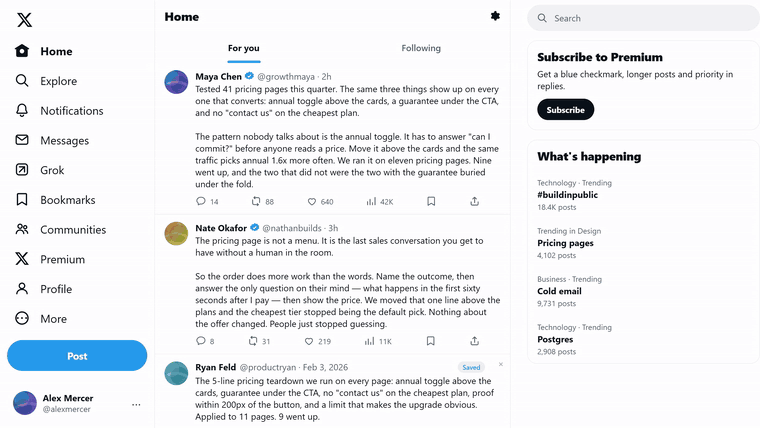

# X Bookmarks Feed

**Your bookmarks, back in your feed.**

A Manifest V3 browser extension that puts the posts you saved back in front of you — as
ordinary rows inside the Home timeline, not as a widget, a dashboard, or another tab you will
never open.

No account. No server. No API key. No tracking. It reads your own bookmarks through the same
request x.com already makes, stores them on your machine, and resurfaces them while you scroll.

<p>
  
  
  
</p>



---

## Install

### Load unpacked (available now)

1. Download `x-bookmarks-3.5.zip` from [Releases](../../releases) and unzip it.
2. Open `chrome://extensions` (or `edge://extensions`).
3. Turn on **Developer mode**.
4. **Load unpacked** → select the unzipped folder (the one containing `manifest.json`).
5. Open `https://x.com` and make sure you are logged in.

That is the whole setup. Defaults are already set, the first sync starts by itself, and you
never have to open the popup.

### Chrome Web Store / Edge Add-ons

The store packages are the same files, built from this repository by the release workflow.
Listing links will be added here when the review completes.

Requires Chrome or Edge **111+**.

---

## What you get

**Rows, not a widget.** Every 10 posts (6 / 10 / 20, your choice) one of your saved posts is
re-inserted as a normal timeline row: same padding, same avatar size, same type scale, a quiet
`Saved` pill and one line explaining why it appeared. No box, no shadow, no banner, no blue
wall. It reads like something X showed you.

**It picks the right save.** By default it chooses the bookmark most similar to the last few
posts you scrolled past, then falls back to the next unsurfaced one. You can switch to
*only related* or plain *next in backlog* in the popup.

**Nothing repeats.** A bookmark is suppressed for 3 days after it appears; `×` hides it for 30.
At most six rows are attached at once, and a row leaves the moment the post it hangs from
leaves the DOM.

**A rail with everything.** Top-right, `40` at a time, with a real `Showing 40 of 5,899` …
`All 5,899 shown` footer. Below 1100px it becomes a small button so it never covers your feed.

**A marker on what you already saved.** A subtle blue edge and `★ Saved` on bookmarks in your
feed, so you stop re-saving the same thing.

**Live un-bookmark.** Remove a bookmark on X and the row and rail entry leave immediately,
instead of waiting for the next daily sync.

---

## Privacy

Everything is local. The extension talks only to `x.com`, only to read your own bookmarks, and
only with the session your browser already has. There is no analytics, no telemetry, no remote
config, no third-party host, and no donation tracking.

Full policy: [PRIVACY.md](PRIVACY.md).

---

## How it works

It calls X's internal web GraphQL `Bookmarks` operation — the same endpoint the x.com web app
uses — authenticated by the cookies already in your browser:

```
GET https://x.com/i/api/graphql/<queryId>/Bookmarks
    authorization: Bearer <public web-client constant>
    x-csrf-token:  <ct0 cookie>
    cookie:        auth_token=<your session>
```

Results are cached in `chrome.storage.local`. An incremental pass reads the newest pages
every few hours (1 / 4 / 12, your choice) and merges them; a full walk runs once a day to catch
deletions made where the extension was not watching.

### The query ID maintains itself

`<queryId>` is a hash of X's compiled operation and X rotates it on every web build. A stale
hash is rejected, so the extension learns the live one: `capture.js` runs in the page's MAIN
world, watches the requests X's own app makes, and can read the operation table out of the
loaded bundle when asked. The next page load re-learns it and the sync retries — no user
action, no release needed for a hash rotation.

### Matching is lexical, and deliberately cheap

1. Take the text of the last 8 posts above the insertion point.
2. Tokenize it and every bookmark — lowercase, drop URLs, mentions, stopwords, pure numbers.
   CJK runs become overlapping two-character grams, since those languages have no spaces.
3. Weight terms by **IDF over your own corpus**, so "people" is noise and "shopify" is signal.
4. Require cosine **≥ 0.12** and **≥ 2 shared informative terms**, filtering by shared terms
   before scoring so one common word can never win.

Indexing thousands of bookmarks takes a few hundred milliseconds, so it happens during idle
time and is cached against a signature of the library. Until it is ready, rows rotate through
the backlog instead of blocking the feed. No model download, no network call, no startup cost.

### A feed that looks wrong is worse than no resurfacing

X ships two timeline layouts, and its Home timeline is virtualized: cells are absolutely
positioned with their offset on the `transform`. A row inserted after a post adds its own
height in flow — pushing later cells down by exactly that much — and is then moved into the
slot it opened, so it sits between two posts and covers neither. Every placement is measured,
re-glued on scroll, resize, tab focus and every few seconds, and removed the instant it would
overlap a post. A row that placement failed to register is swept on the next pass.

If placement fails three times in a row, resurfacing switches itself off for that page load
with a console note. The rail, the markers and your cache are unaffected. The failure mode is
"do nothing", never "do something broken".

---

## Limits, stated plainly

- **X can change under it.** The GraphQL hash is self-healing, but a structural change to the
  timeline or the bookmarks payload may need a release. The extension degrades to "no rows"
  instead of a broken feed.
- **You must be logged in.** There is no OAuth app, no token to paste, no server to trust —
  which also means it cannot sync bookmarks for an account you are not signed into.
- **Lexical matching, not semantic.** Two posts about the same idea with no shared vocabulary
  will not match. That is the price of zero network calls and zero model downloads.
- **Chrome/Edge only.** Firefox needs a different extension surface; it is not supported.

---

## Support the project

It is free and stays free. If it earns a place in your feed, you can send ETH / EVM:

```
0xe75fe7492D16dB9f133dA20De2F2a1AA68406977
```

The same address is in the popup — click it to copy. Verify the last four characters are
`6977` before sending; addresses are the one thing malware likes to swap.

---

## License

[MIT](LICENSE). The name and logo are not covered by the license — forks are welcome, but
please ship them under their own name.
